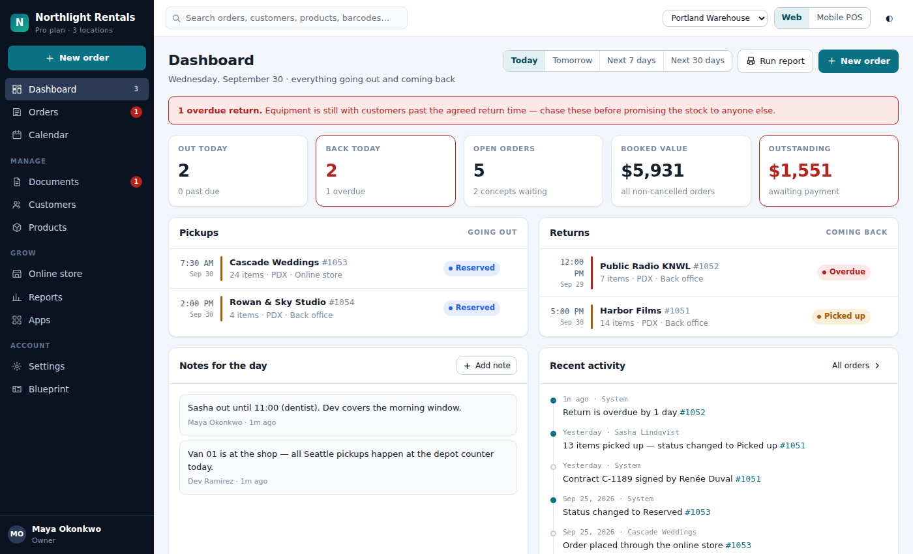
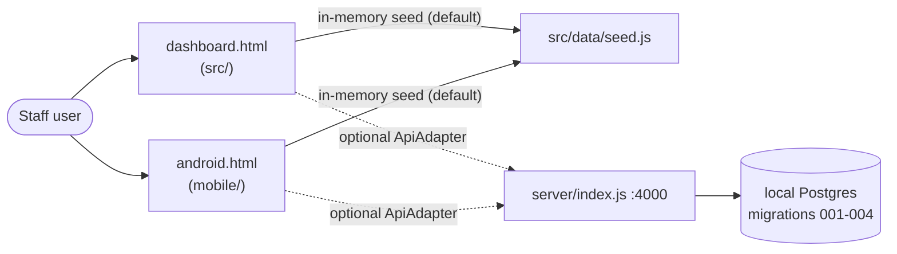

# Booqable Operator Console (rebuild)

A clickable reconstruction of a Booqable-style rental back office for an invented company, "Northlight Rentals", with a Postgres-backed API.

## What it is

A prototype of the staff-side dashboard of a rental-shop system: orders, calendar and availability, documents, customers, products and stock, online store settings, reports. It ships as a web dashboard and an Android-style Mobile POS, both driven by the same in-browser state. All company data is invented, and it is not connected to any real Booqable account or business.



The screenshot is `dashboard.html` opened straight from disk.

## How it works

- `src/`: the web app. `src/core` (registry, store, ui, and memory/api/rest adapters), `src/modules` (dashboard, orders, calendar, documents, customers, products, storefront, reports, apps, settings, pos, blueprint, shell), `src/schema` (entities and the order lifecycle), `src/data/seed.js` (demo data). Core does not know screen names; navigation and actions come from the registry.
- `mobile/`: the Android-style app (`mobile/main.js`, `screens/`, `flows.js`, `store.js`).
- `build.mjs`: dependency-free bundler that produces `dashboard.html` and `android.html`. Those two files are committed build output. `dev.html` loads `src/` as native ES modules.
- `server/index.js`: plain Node `http` server (commands `serve`, `migrate`, `seed`, `reset`). `server/lib/api.js` holds the route table, with role checks per route: `/api/auth/signin`, `/api/bootstrap`, `/api/availability`, `/api/orders` (plus `/:id`, `/lines`, `/reserve`, `/pickup`, `/return`, `/status`, `/payments`, `/documents`), `/api/products`, `/api/stock-items/:id`, `/api/customers`, `/api/reports/pull-sheet`, `/api/reports/utilisation`.
- `server/migrations/`: `001_schema.sql` (tables), `002_logic.sql` (business rules in SQL), `003_rls.sql` (per-tenant row-level security), `004_auth_functions.sql`.
- `server/test.js` and `server/e2e.js`: tests against a real local Postgres.
- Docs in the repo: `ARCHITECTURE.md`, `ANDROID.md`, `BACKEND.md`, `DASHBOARD-MAP.md`.

## Run it

Front ends only, no server (in-memory seed data):

```bash
npm run build          # rebuild dashboard.html and android.html
open dashboard.html    # or android.html
python3 -m http.server 8080   # then open /dev.html for unbundled modules
```

With the Postgres backend (needs `npm install`, which pulls the only dependency, `pg`, and a local Postgres):

```bash
npm run db:reset && npm run api    # API on PORT (default 4000)
npm test                           # test:api + test:e2e
```

Environment variables read by the server: `PORT`, `CORS_ORIGIN`, `PGHOST`, `PGPORT` (default 55432), `PGDATABASE`, `PGUSER`, `PGPASSWORD`, `PGOWNER`, `PGOWNERPASS`. Demo sign-in details for the front end are in `BACKEND.md`. Edit `src/`, not the built HTML files.

## Status

Stalled: a substantial reference prototype with fake data, last worked on in August 2026, and not wired into the GCR/CyberCheck platform.

## Where it fits



It calls no other CultureReset repo and no Supabase project; the only data path is its own local server.

## Related repos

- Fareharbor: same style of prototype (in-memory seed data plus docs) from the same period.
- user-owned-environment-briefing: lists "Booqable" as a surface that consumes the warehouse; no code in this repo does that yet.
- No code is copied from other repos.
